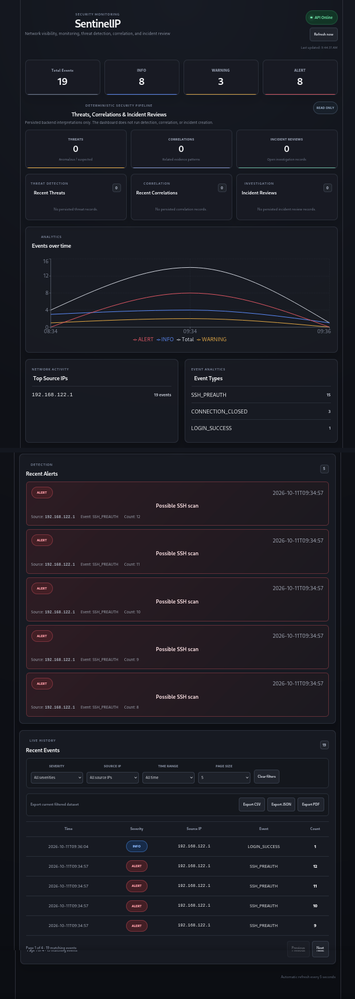

# SentinelIP

SentinelIP is a defensive cybersecurity platform for observing an authorized
network, understanding changes and security signals, and identifying what
deserves review.

> See what is there. Understand what is happening. Know what needs attention.



The project is built around a deterministic, auditable security core. Optional
runtime coordination layers can read established SentinelIP state, but they do
not replace the underlying detection, assessment, correlation, or incident
semantics.

## What SentinelIP does

SentinelIP currently brings together four defensive capabilities:

- **Network Visibility** — authorized private-network discovery, device
  inventory, port/service observations, and change history.
- **Security Monitoring** — SSH event monitoring plus browser and DNS telemetry.
- **Security Assessment** — deterministic risk findings and conservative CVE
  correlation.
- **Threat Review & Correlation** — bounded threat detection, correlation, and
  explicit incident-review records.

The security interpretation hierarchy is:

`Raw Observation → Detection / Change / Finding → Threat → Correlation → Incident Review`

Each layer remains distinct. A finding, threat, correlation, or incident review
is not automatically proof of compromise, malware, phishing, exploitation, or
attacker identity.

## Project documentation

- [Frontend dashboard](frontend/README.md)
- [Browser telemetry sensor](browser-extension/README.md)
- [DNS telemetry sensor](dns-sensor/README.md)
- [Security policy](SECURITY.md)

## Architecture

The main backend areas are:

- `collectors/` — observational collectors such as SSH log collection.
- `services/` — deterministic discovery, inventory, assessment, detection,
  correlation, incident, telemetry, and reporting logic.
- `database/` — SQLite persistence, migrations, and bounded read/write helpers.
- `api/` — FastAPI presentation and telemetry/network-management endpoints.
- `frontend/` — React/Vite dashboard.
- `browser-extension/` — observational browser telemetry sensor.
- `dns-sensor/` — DNS telemetry sensor.
- `tool_layer/` — typed, allow-listed read-only security-state tools.
- `runtime_specialists/` — bounded read-only specialist routing.
- `sentinel_orchestrator/` — deterministic coordination over specialists.

The optional runtime path is:

`Caller → OrchestratorRequest → SentinelIPOrchestrator → SpecialistRegistry → ReadOnlySpecialist → ToolRegistry → ToolPolicy → deterministic persisted state`

The orchestrator does not directly access databases, scanners, engines, shell
commands, or operating-system execution primitives.

## Defensive safety boundaries

SentinelIP is intentionally defensive.

The current project does not provide:

- exploitation
- credential attacks
- arbitrary Internet-wide scanning
- automatic intrusive scan profiles
- autonomous remediation
- firewall/network reconfiguration
- browser blocking
- packet interception or HTTPS MITM
- external reputation or intelligence lookups
- autonomous agent loops
- model-generated security actions

Network discovery is constrained by explicit target policy and authorized
private-network scope.

Deterministic SentinelIP services remain authoritative. Optional runtime layers
do not create new persisted security meaning.

## Network discovery and inventory

Network discovery uses scanner abstractions with a conservative Nmap adapter.
The authorization boundary is enforced before discovery activity.

The inventory layer keeps device and service history rather than treating a
single IP address as permanent device identity. Change detection and risk
assessment are separate from raw discovery.

## Telemetry

### SSH

SentinelIP can monitor SSH authentication-related events and apply deterministic
rules to persisted event history.

### Browser sensor

The browser sensor records bounded structural telemetry intended for defensive
review. It does not capture passwords, form values, cookies, page text,
screenshots, or keystrokes.

### DNS sensor

The DNS sensor provides a separate observational telemetry source. DNS data is
not automatically treated as proof of malicious activity.

## Security interpretation

SentinelIP separates observation from interpretation:

- **Detections / Changes / Findings** represent local deterministic review
  results.
- **Threats** represent bounded suspicious or anomalous patterns.
- **Correlations** group established signals under explicit deterministic rules.
- **Incident Reviews** are explicit investigation objects.

Incident Reviews do not establish causality, compromise, a common actor, or
successful exploitation.

## Read-only runtime layer

The current tool catalog is deliberately small:

- `list_threats`
- `get_threat`
- `list_correlations`
- `get_correlation`
- `list_incidents`
- `get_incident`

The runtime specialist catalog contains:

- `threat_review`
- `correlation_review`
- `incident_review`

The optional orchestrator exposes fixed typed operations for security overview,
list, and detail review. There is no LLM provider, natural-language planner,
autonomous loop, background agent, or model-generated action in the current
runtime.

## API and dashboard

The FastAPI backend exposes existing event, analytics, reporting,
authorized-network, telemetry, and read-only security-review functionality.

Threat, correlation, and incident review endpoints are read-only.

The React dashboard presents established backend state. It does not run threat
detection, create correlations, open incidents, or mutate security
interpretation.

## Reports

SentinelIP can generate filtered CSV, JSON, and PDF security reports from
persisted data.

Generated reports and local runtime databases are development/runtime artifacts,
not source-of-truth project code.

## Quick Start

The verified development baseline uses Python 3.14 and Node.js for the frontend
and browser sensor.

Create and activate a Python virtual environment:

```bash
python -m venv .venv
source .venv/bin/activate
```

Install runtime dependencies:

```bash
python -m pip install -r requirements.txt
```

For development and test work, install the test dependency set instead:

```bash
python -m pip install -r requirements-dev.txt
```

Start the FastAPI backend from the repository root:

```bash
python -m uvicorn api.main:app --reload --host 127.0.0.1 --port 8000
```

The dashboard expects the API at `http://127.0.0.1:8000`.

In another terminal, start the React frontend:

```bash
cd frontend
npm install
npm run dev
```

The Vite development server is allowed by the local API CORS configuration at
`http://127.0.0.1:5173` and `http://localhost:5173`.

Browser and DNS telemetry require explicitly provisioned local sensor
credentials. Follow `browser-extension/README.md` and `dns-sensor/README.md`
rather than placing sensor tokens in tracked files.

## Tests

Run the backend suite from the repository root:

```bash
python -m pytest -q
```

Run DNS sensor tests:

```bash
python -m pytest -q dns-sensor/tests
```

Run browser sensor tests:

```bash
cd browser-extension
npm test
```

Run frontend checks:

```bash
cd frontend
npm run lint
npm run build
```

At the Release Readiness 01 checkpoint, the verified baseline was:

- 607 backend tests passing
- 102 DNS sensor tests passing
- 11 browser-extension tests passing
- frontend lint passing
- frontend production build passing

## Development status

SentinelIP is under active development.

The current architecture provides a tested defensive foundation for network
visibility, monitoring, assessment, threat review, correlation, incident
review, and bounded optional runtime coordination.

Future capabilities should preserve the same principles:

- authorized scope
- deterministic security authority
- explicit evidence boundaries
- narrow typed interfaces
- auditable behavior
- no unsupported claims of compromise
- no autonomous offensive actions
