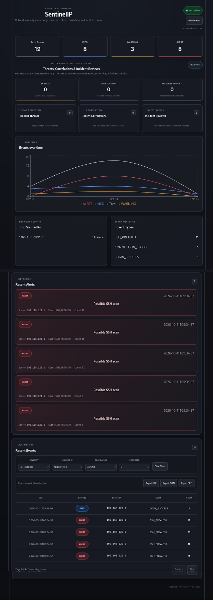

# SentinelIP

SentinelIP is a defensive cybersecurity platform for observing an authorized
network, understanding changes and security signals, and identifying what
deserves review.

> See what is there. Understand what is happening. Know what needs attention.



The project is built around a deterministic, auditable security core. Optional
runtime coordination layers can read established SentinelIP state, but they do
not replace the underlying detection, assessment, correlation, or incident
semantics.

## What SentinelIP does

SentinelIP currently brings together four defensive capabilities:

- **Network Visibility** — authorized private-network discovery, device
  inventory, port/service observations, and change history.
- **Security Monitoring** — SSH event monitoring plus browser and DNS telemetry.
- **Security Assessment** — deterministic risk findings and conservative CVE
  correlation.
- **Threat Review & Correlation** — bounded threat detection, correlation, and
  explicit incident-review records.

The security interpretation hierarchy is:

`Raw Observation → Detection / Change / Finding → Threat → Correlation → Incident Review`

Each layer remains distinct. A finding, threat, correlation, or incident review
is not automatically proof of compromise, malware, phishing, exploitation, or
attacker identity.

## Local dashboard (current `main`)

The Linux development checkout includes a React/Vite dashboard backed by the
local FastAPI Core. The dashboard offers seven persistent workspace modules:

- **Overview** — the four backend-owned event/severity totals, a compact recent
  activity chart, and up to three recent alert previews.
- **Scope & Discovery** — authorized scope, inventory, discovery and investigation
  entry points.
- **Remote Sensors** — sensor fleet, management and bounded task workflows.
- **Operations** — operational workload and explicit Incident Review workflows.
- **Detections** — existing security detections and investigation context.
- **Perimeter** — available perimeter and external-exposure review views.
- **Events & Analytics** — event history, timeline, filters and bounded exports.

**Data Lifecycle** is a separate local-operator destination; **Help & User Guide**
and **About SentinelIP** are separate support destinations. The desktop layout
uses a sidebar and narrow screens provide a Workspace menu. Hash-based routes
support direct links and browser Back/Forward without remounting the workspace
or discarding its form and filter state.

These UI features are included in local source checkpoint `1eec263` and are
not part of the earlier tagged `v1.0.1` source release. The UI does not imply a
packaged Linux or Windows desktop installer.

## Project documentation

- [Frontend dashboard](frontend/README.md)
- [Browser telemetry sensor](browser-extension/README.md)
- [DNS telemetry sensor](dns-sensor/README.md)
- [Security policy](SECURITY.md)

## Architecture

The main backend areas are:

- `collectors/` — observational collectors such as SSH log collection.
- `services/` — deterministic discovery, inventory, assessment, detection,
  correlation, incident, telemetry, and reporting logic.
- `database/` — SQLite persistence, migrations, and bounded read/write helpers.
- `api/` — FastAPI presentation and telemetry/network-management endpoints.
- `frontend/` — React/Vite dashboard.
- `browser-extension/` — observational browser telemetry sensor.
- `dns-sensor/` — DNS telemetry sensor.
- `tool_layer/` — typed, allow-listed read-only security-state tools.
- `runtime_specialists/` — bounded read-only specialist routing.
- `sentinel_orchestrator/` — deterministic coordination over specialists.

The optional runtime path is:

`Caller → OrchestratorRequest → SentinelIPOrchestrator → SpecialistRegistry → ReadOnlySpecialist → ToolRegistry → ToolPolicy → deterministic persisted state`

The orchestrator does not directly access databases, scanners, engines, shell
commands, or operating-system execution primitives.

## Defensive safety boundaries

SentinelIP is intentionally defensive.

The current project does not provide:

- exploitation
- credential attacks
- arbitrary Internet-wide scanning
- automatic intrusive scan profiles
- autonomous remediation
- firewall/network reconfiguration
- browser blocking
- packet interception or HTTPS MITM
- external reputation or intelligence lookups
- autonomous agent loops
- model-generated security actions

Network discovery requires a persisted, explicitly authorized and bounded
scope. Supported targets are private IPv4 networks (up to /24), a single public
IPv4 address, a hostname bound to its confirmed resolved IPv4 addresses, and
small public IPv4 CIDRs containing at most eight addresses. Locally discovered
network candidates remain untrusted until separately authorized. SentinelIP
does not support unauthorized or unbounded Internet-wide scanning.

Deterministic SentinelIP services remain authoritative. Optional runtime layers
do not create new persisted security meaning.

## Network discovery and inventory

Network discovery uses scanner abstractions with a conservative Nmap adapter.
The authorization boundary is enforced before discovery activity.

The inventory layer keeps device and service history rather than treating a
single IP address as permanent device identity. Change detection and risk
assessment are separate from raw discovery.

## Telemetry

### SSH

SentinelIP can monitor SSH authentication-related events and apply deterministic
rules to persisted event history.

### Browser sensor

The browser sensor records bounded structural telemetry intended for defensive
review. It does not capture passwords, form values, cookies, page text,
screenshots, or keystrokes.

### DNS sensor

The DNS sensor provides a separate observational telemetry source. DNS data is
not automatically treated as proof of malicious activity.

## Security interpretation

SentinelIP separates observation from interpretation:

- **Detections / Changes / Findings** represent local deterministic review
  results.
- **Threats** represent bounded suspicious or anomalous patterns.
- **Correlations** group established signals under explicit deterministic rules.
- **Incident Reviews** are explicit investigation objects.

Incident Reviews do not establish causality, compromise, a common actor, or
successful exploitation.

## Read-only runtime layer

The current tool catalog is deliberately small:

- `list_threats`
- `get_threat`
- `list_correlations`
- `get_correlation`
- `list_incidents`
- `get_incident`

The runtime specialist catalog contains:

- `threat_review`
- `correlation_review`
- `incident_review`

The optional orchestrator exposes fixed typed operations for security overview,
list, and detail review. There is no LLM provider, natural-language planner,
autonomous loop, background agent, or model-generated action in the current
runtime.

## API and dashboard

The FastAPI backend exposes event, analytics, reporting, authorized-network,
telemetry, read-only threat/correlation review and explicit operator-managed
Incident Review workflows. Some management operations are state-changing and
require deliberate operator actions and their existing backend safeguards.

The React dashboard displays backend-derived security signals. It does not
independently run detection or correlation engines, infer compromise, or
create security meaning. It can issue bounded, explicit requests to create and
manage Incident Review records, attach evidence and perform other supported
operator workflows; the backend remains authoritative for validation, state
and security interpretation.

## Reports

SentinelIP can generate filtered CSV, JSON, and PDF security reports from
persisted data.

Generated reports and local runtime databases are development/runtime artifacts,
not source-of-truth project code.

## Quick Start

The verified development baseline uses Python 3.14 and Node.js for the frontend
and browser sensor.

Create and activate a Python virtual environment:

```bash
python -m venv .venv
source .venv/bin/activate
```

Install runtime dependencies:

```bash
python -m pip install -r requirements.txt
```

For development and test work, install the test dependency set instead:

```bash
python -m pip install -r requirements-dev.txt
```

Start the FastAPI backend from the repository root:

```bash
python -m uvicorn api.main:app --reload --host 127.0.0.1 --port 8000
```

File-backed SentinelIP Core databases are currently supported on POSIX systems
with the database permission contract described in
[`docs/core-database-permissions-36c.md`](docs/core-database-permissions-36c.md).
File-backed Core startup on Windows intentionally fails closed until a verified
Windows ACL implementation is available. This does not change the separately
packaged Windows sensor support.

The dashboard expects the API at `http://127.0.0.1:8000`.
This is the default when `VITE_SENTINELIP_API_BASE` is unset. For sensor-enabled
direct-TLS Core deployment, set the frontend variable explicitly to the loopback
API URL (for example, `https://127.0.0.1:8443`). Remote sensors use the Core DNS
name; the local frontend uses loopback. See
[`docs/operator-boundary-21d.md`](docs/operator-boundary-21d.md) for the
deployment, certificate, and operator-boundary contract.

In a separate terminal, start the React frontend from the repository root:

```bash
cd frontend
npm ci
npm run dev -- --host 127.0.0.1 --port 5173 --strictPort
```

Open `http://127.0.0.1:5173/`. Keep the API process running separately on
`127.0.0.1:8000`. Check its read-only health endpoint with:

```bash
curl -i http://127.0.0.1:8000/health
```

These are **development commands**, not a one-click installer or automatically
managed background service. Do not assume a running Vite server also starts
FastAPI; use separate terminals and avoid starting a second server on a busy
port. Database-backed API operations can change local state; use authorized
scopes and explicit operator approval for actions that mutate data.

The Vite development server is allowed by the local API CORS configuration at
`http://127.0.0.1:5173` and `http://localhost:5173`.

Browser and DNS telemetry require explicitly provisioned local sensor
credentials. Follow `browser-extension/README.md` and `dns-sensor/README.md`
rather than placing sensor tokens in tracked files.

## Tests

Run the backend suite from the repository root:

```bash
python -m pytest -q
```

Run DNS sensor tests:

```bash
python -m pytest -q dns-sensor/tests
```

Run browser sensor tests:

```bash
cd browser-extension
npm test
```

Run frontend checks:

```bash
cd frontend
npm run lint
node --test tests/*.test.js
npm run build
```

At local source checkpoint `1eec263` (2026-11-07), the frontend checks were
reported as **194/194 Node tests passing**, with ESLint and Vite build PASS
on Kali Linux. This is a **frontend-only** verification; it is not a complete
backend, sensor, end-to-end or desktop packaging certification. The Vite build
still reports a non-blocking large JavaScript chunk warning.

At the earlier Release Readiness 01 checkpoint, the verified baseline was:

- 607 backend tests passing
- 102 DNS sensor tests passing
- 11 browser-extension tests passing
- frontend lint passing
- frontend production build passing

## Releases

Latest tagged source release at this documentation update: **v1.0.1**
(2026-11-06). The current `main` development checkpoint `1eec263` is newer,
but it is **not** a new tagged release.

The v1.0.1 source archive has been verified against the Git release tag:
517 files matched, with no missing, extra, or changed files.

The v1.0.1 update adds frontend investigation-navigation null guards and
SentinelIP application branding.

The latest fully documented historical test baseline remains v0.1.0.
A complete v1.0.1 Python test-suite PASS has not yet been established.

See [CHANGELOG.md](CHANGELOG.md) for release notes and verification scope.

## Development status

SentinelIP is under active development.

The current architecture provides a tested defensive foundation for network
visibility, monitoring, assessment, threat review, correlation, incident
review, and bounded optional runtime coordination.

Future capabilities should preserve the same principles:

- authorized scope
- deterministic security authority
- explicit evidence boundaries
- narrow typed interfaces
- auditable behavior
- no unsupported claims of compromise
- no autonomous offensive actions
